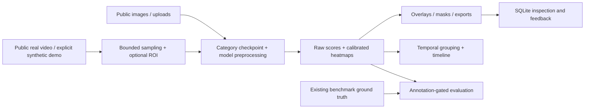

# VisionGuard: image and video industrial anomaly inspection

Local PyTorch/Anomalib application with Gradio image, batch, video, dataset,
evaluation and history tabs. PatchCore and EfficientAD use real trained category
weights and return actual anomaly maps. No external paid inference API is used.

## Start the prepared project

```powershell
.\.venv\Scripts\python.exe app.py
```

Open http://127.0.0.1:7860. If using a pre-existing validated environment, `python
app.py` also starts the app, but read [environment compatibility](docs/ENVIRONMENT.md).
Weights load on demand; available architectures are not advertised as already loaded.

## Installation

Python 3.12 was used locally (3.11 is a package-supported alternative).
Use an isolated environment with a matched CPU PyTorch/torchvision pair:

```powershell
python -m venv .venv
.\.venv\Scripts\python.exe -m pip install torch==2.10.0 torchvision==0.25.0 --index-url https://download.pytorch.org/whl/cpu
.\.venv\Scripts\python.exe -m pip install -r requirements.txt
```

For GPU use the corresponding official PyTorch CUDA wheels. Details and the distinction
between the inherited legacy environment and supported target are in docs/ENVIRONMENT.md.

## Datasets and existing trained models

MVTec AD and VisA are image benchmarks, not video datasets. Existing local MVTec
images are in `mvtec_anomaly_detection`, and VisA in `datasets/visa`.
MVTec is CC BY-NC-SA 4.0; VisA is CC BY 4.0. Preserve official splits and attribution.
See [dataset preparation](docs/DATASETS.md).

```powershell
python scripts/validate_dataset.py --dataset mvtec_ad --root mvtec_anomaly_detection
python scripts/validate_dataset.py --dataset visa --root datasets/visa
python scripts/download_public_efficientad.py
```

Public EfficientAD detectors cover all 15 MVTec categories plus VisA pcb1; the downloader
pins publisher revisions and records source URLs and checksums. Existing PatchCore
weights cover MVTec and VisA categories. No new training is needed to start this project.
See [model provenance and limitations](docs/MODELS.md) and generated `docs/model_cards`.

## Image, batch and evaluation

Upload an image and choose its known category and architecture. Adjust the operational
image threshold, pixel threshold and minimum region area. Download an inspection ZIP
containing images, actual raw/calibrated maps and a JSON report. Batch uploads return
per-image results and CSVs, including partial failures. SQLite stores inspections and
human feedback separately from benchmark labels; feedback never triggers training.

```powershell
python scripts/run_demo.py --model efficientad --category bottle
python scripts/evaluate.py --model efficientad --category bottle --root mvtec_anomaly_detection
python scripts/benchmark.py --categories bottle --root mvtec_anomaly_detection
python scripts/benchmark.py --dataset visa --categories pcb1 --root datasets/visa
# Faster, explicitly labeled balanced test-subset comparison:
python scripts/benchmark.py --categories bottle --limit-per-class 5
# Robustness on copied evaluation images; no test threshold fitting:
python scripts/benchmark.py --categories bottle --limit-per-class 2 --corruptions none brightness blur jpeg
```

Corrected reports include AUROC/AP, precision/recall/F1, confusion matrix, pixel metrics,
finite-threshold AUPRO approximation, latency, hardware, dependencies, checkpoint identity
and exact sample manifests. Normal test images count toward pixel false positives.
Old reports are retained for audit but hidden because their IoU/Dice calculation was
incorrect. Ten-image smoke results are not full-test benchmark scores. Third-party
checkpoint selection may have used test data; matched inference is not matched training.
See [evaluation definitions](docs/EVALUATION.md).

## Public video: no recording required

```powershell
python scripts/prepare_commons_conveyor.py
python scripts/make_demo_video.py --root mvtec_anomaly_detection --category bottle
python scripts/inspect_video.py datasets/public_videos/commons_gigaset_conveyor/conveyor.mp4 --model efficientad --category bottle --max-duration 5
```

The Video Inspection tab selects prepared public examples or accepts an existing
MP4/AVI/MOV. The included real conveyor recording is licensed CC BY with attribution
and a verified original checksum. It has **no defect ground truth** and is used only
qualitatively. Existing MVTec weights are out of domain for its packages. The optional
bottle sequence is explicitly synthetic, watermarked, and generated from benchmark
images; it is not evidence of real-world video performance.

The streaming pipeline saves sampled-frame heatmap overlays, H.264 output, a score
timeline/gallery, frame/event CSVs, compressed score maps, metadata and a provenance
report. It supports bounded duration/sampling, a fixed product ROI and temporal event
aggregation. Unsampled frames are identified. Events are not counts of defective products.
Metrics stay null unless complete ground-truth coverage is provided; annotation-aware
frame AUROC and one-to-one event metrics are available without inventing labels.
See [sources and licence checks](docs/PUBLIC_VIDEOS.md) and [video workflow](docs/VIDEO_PIPELINE.md).

## Training (not performed during completion)

```powershell
python scripts/train.py --model patchcore --dataset mvtec_ad --category bottle --root mvtec_anomaly_detection
python scripts/train.py --model efficientad --dataset mvtec_ad --category bottle --root mvtec_anomaly_detection
```

EfficientAD uses normal images and training batch size one. Use the corrected Colab
notebook for GPU training with resumable Drive checkpoints. New conveyor-specific
EfficientAD training may take more than two hours on CPU; no such job has been launched.

## Tests

```powershell
$env:PYTHONPATH="src"
$env:GRADIO_ANALYTICS_ENABLED="False"
.\.venv\Scripts\python.exe -m pytest tests -q --basetemp artifacts/pytest_run
```

Small fixtures cover metric correctness, missing masks, partial batch failures, streaming
video/heatmaps/reports, ground-truth gating, temporal matching, exports, cleanup, model
resolution, preprocessing, SQLite and app creation. They do not download whole datasets.
Real-checkpoint image/video checks are separate commands and need the local datasets.

## Architecture and boundaries



Optional object tracking, supervised segmentation, high-resolution tiling, cloud
hosting and MVTec AD 2 are not prerequisites and are not claimed implemented.
No labeled public conveyor benchmark has been verified and integrated. Public video
inference still works. Full all-category/robustness benchmark sweeps have not been run.
The Flask interface is legacy; Gradio is the maintained interface for the new workflow.
